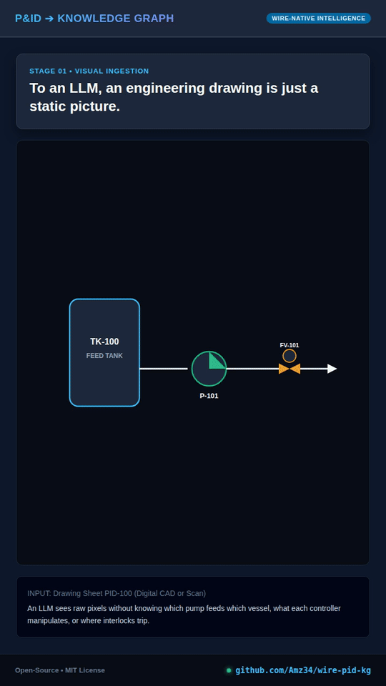

# P&ID to Knowledge Graph

Turn P&ID drawings into a process knowledge graph that an LLM can reason over.

`wire-pid-kg` reads piping and instrumentation diagrams (P&IDs) and PFDs from PDF and builds a knowledge graph of the process. The PDFs can be digital (exported from CAD) or scanned. The graph captures:

- **Process flow:** what is upstream and downstream of every tank, pump, valve and pipe segment.
- **Measurement:** which instrument measures which variable, and exactly where it sits in the flow.
- **Control:** control loops from sensor through controller to final element, including I/P relays, cascades, interlocks and VFD drives.

The output is meant to be one layer of an industrial manufacturing **context layer**. An LLM application can query it to answer questions such as "what feeds this clarifier?", "which transmitters sit downstream of P-101?" or "what does FIC-0502 manipulate?" directly from the drawings themselves.

## Demo Walkthrough

<p align="center">
  
</p>
<p align="center">
  <em>Watch the full high-resolution demo video: <a href="docs/demo_walkthrough.mp4">docs/demo_walkthrough.mp4</a></em>
</p>

## Quick start

No programming is needed. You need [Claude Code](https://code.claude.com/docs/en/overview) (the desktop app or the terminal version) and [Python](https://www.python.org/downloads/) 3.10 or newer. Python 3.12 is the best choice: on 3.13 and later the skill still works, but without the text-recognition (OCR) cross-check and automatic page orientation.

### 1. Download the skill
Clone or download this repository.

### 2. Install it
In the folder, open `skills` and copy the `wire-pid-kg` folder into your personal skills directory:

| System | Skills folder |
|---|---|
| Windows | `C:\Users\<your user name>\.claude\skills\` |
| macOS / Linux | `~/.claude/skills/` |

If the `skills` folder doesn't exist yet, create it.

### 3. Add your P&IDs
Make a new folder for the project and put your P&ID PDF in it. Open that folder in your coding environment.

### 4. Convert them
For example:

> Convert `plant_drawings.pdf` into a knowledge graph. The P&IDs are on pages 47–60.

The skill loads automatically; there is no need to name it. The first time, it installs the Python packages it needs. It reads every sheet in detail, confirms revisions if multiple versions exist, and reports what it found and what remains uncertain.

### 5. Check the graph by asking questions
The best test is to ask about things you can verify on the drawings:

> Name all the equipment upstream of the clarifier.
>
> What sensor measures the flow into TK-101, and where exactly is it?
>
> What does FIC-0502 control, and what valve does it move?

The results are saved in `work/<plant name>/kg/` inside your project folder:
- `summary.md` is a readable overview of the whole plant.
- `qa_report.md` lists anything that could not be confirmed.
- `graph.json` contains the full graph.
- `graph.duckdb` is an embedded SQL database for recursive graph traversal.

## How it works

The agent reads the drawings; Python scripts handle deterministic validation and graph generation:

### 1. Preparing the pages
A script inspects every page and determines its drawing category:

| Page type | How to recognise it | What the engine does |
|---|---|---|
| **Digital, searchable text** | Exported from CAD; text can be selected in a PDF viewer | Renders the page straight from vector data so lines stay sharp at any zoom. Vector text cross-checks extracted tags. |
| **Digital, outlined text** | Drawn as vector shapes; text cannot be highlighted | High-resolution vector rendering with OCR text recognition for tag cross-checks. |
| **Scanned** | Raster image of a paper drawing | Enhances contrast and resolution up to 2.5× so small text stands out. Runs OCR cross-checks. |
| **Scanned with OCR text** | Raster drawing with searchable text layer | Uses added text layer as hints while prioritizing verified visual elements. |

Then, for every page:
- **Orientation:** Ensures text is upright.
- **Resolution:** Computed from text size so small tags stay legible.
- **Tiles:** Slices large drawings into overlapping inspection tiles while skipping blank margins.

### 2. Reading each sheet
- The sheet is reviewed as a whole, then every tile up close.
- Captures equipment, pipe runs, valves, instruments, signal lines, and off-page connectors.
- Records bounding coordinates and confidence scores. Unreadable items are flagged, never guessed.

### 3. Building and checking the knowledge graph
- **Process flow:** Pipes are split into segments between in-line valves and fittings; off-page connectors link sheets to trace full plant flows.
- **Measurement:** Instruments attach to specific pipe segments or vessels.
- **Control:** Loops assemble from ISA-5.1 tags and signal lines (sensor $\to$ controller $\to$ valve/drive).
- **Integrity check:** A validation report flags missing partner connectors, unlocated transmitters, or unmatched OCR tags.

### 4. Querying and export
- `summary.md`: Structured plant overview for LLM context.
- `graph.json`: Machine-readable graph conforming to `graph.schema.json`.
- `graph.duckdb`: Embedded SQL store for fast recursive upstream and downstream queries.
- Export options include GraphML (Gephi / yEd / NetworkX) and Neo4j Cypher scripts.

## Outputs

| File | Description |
|---|---|
| `summary.md` | Readable plant overview: equipment-level flow, instruments, control loops, and off-page connectors. Ideal for LLM context. |
| `qa_report.md` | Integrity audit detailing errors, warnings, and unconfirmed tags. |
| `graph.json` | The complete graph conforming to `references/schema/graph.schema.json`. |
| `graph.duckdb` | High-performance [DuckDB](https://duckdb.org) file for SQL path traversal. |

Equipment and instruments map directly to [DEXPI](https://dexpi.org) classes for standard P&ID data interchange.

## Repository layout

```
skills/wire-pid-kg/
  SKILL.md                    Inspection and extraction workflow
  references/                 Extraction guidelines, ISA-5.1 reference, symbol guide, ontology, JSON schemas
  scripts/                    probe, render, hints, build, query, export, eval, crop
  scripts/pidkg/              Library: models, ISA parsing, builder, loops, QA, storage, summary
docs/                         Architecture diagrams
tests/                        Pytest test suite with synthetic drawing sets
```

## Limitations

- **Extraction quality depends on legibility:** Low-resolution scans can obscure fine tag text; unreadable items are recorded as unreadable rather than guessed.
- **Control logic:** Captures loops shown on the P&ID (ISA bubbles and signal lines); external logic living purely in narrative control descriptions is not represented.
- **Flow direction:** Inferred from equipment conventions and flow arrows; ambiguous runs are explicitly flagged as inferred.

## Development

```bash
pip install -e ".[dev]"
pytest
python skills/wire-pid-kg/scripts/build_kg.py --write-schemas
```

## Disclaimer

The graph is machine-extracted from engineering drawings. It must be reviewed by a qualified engineer before use in design, operations, management of change, or process safety studies (HAZOP/LOPA).

## License

[MIT](LICENSE).
